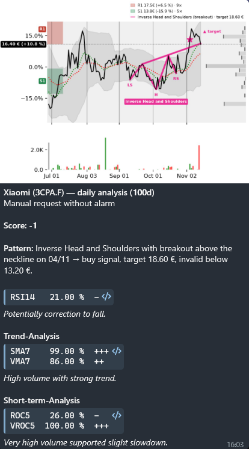

# Understanding Alerts and Charts

[← back to the README](../readme.md)

## When CaSa sends what

| Time | What happens |
|---|---|
| every hour | Crypto: 100-hour analysis (alarms and infos) and plan alerts (buy zone, target) |
| 08:00 | Reminder for tomorrow's dates (`events.ini`) and quarterly results, with chart |
| 09:30 and 12:30 | Daily analysis of all assets with `1` (stocks Monday to Friday) |
| 18:30 | Evening summary: ranking, daily P&L and the 13-week P&L chart |
| 19:00 | Check for a new CaSa version |

Started after 12:30, the daily analysis runs at once. With `test_mode = 1` all analyses run once at the start.

## Alarms and infos

CaSa sends two kinds of messages, and you choose for every signal – separately for stocks and crypto – whether it comes as an alarm, as an info or not at all: in `config.ini` `[alerts]` (required, created automatically) or in Telegram with `/smart_alert_config`.

- **🔔 Alarm**: header "Potential buy" / "Potential sell", can be marked as important, recorded in the alarm journal (monthly report)
- **ℹ️ Info**: the asset in bold, below it "ℹ️ Info: …" with the trigger, never marked as important, not part of the alarm journal

| Signal | Switch | Default stocks; crypto | Meaning |
|---|---|---|---|
| Positive-5 | `positive5` | alarm; alarm | 5-period rate of change rises above `seven_day_price_change` (first value above it); only above the SMA200 |
| Score>8 | `score8` | info; alarm | Internal score (-18 to +18) rises above 8 for the first time (daily only); only above the SMA200 |
| Oversold | `oversold` | alarm; off | The internal score falls to -8 or lower for the first time (strong sell-off, possible rebound; daily only, no SMA200 filter, never marked as important) |
| Trend turns down | `cross_ema_sell` | alarm; alarm | Fast EMA (12) crosses the slow EMA (26) downwards (daily only, only for assets you own) |
| Loss limit | `loss_limit` | alarm; alarm | The total P&L of a position you own (value vs. FIFO buy price) falls below `total_loss_limit` in `[alertsconfig]` (e.g. -5 %); on the day it crosses the limit, again after a recovery above it (daily only). A risk alarm for your own limit, not a forecast |
| Trend turns up | `cross_ema_buy` | info; info | Fast EMA (12) crosses the slow EMA (26) upwards (daily only) |
| Sharp drop | `negative5` | info; info | Price falls more than `seven_day_price_change` in 5 periods (first value below it) |
| New 100-day high | `high100` | info; alarm | Highest closing price of the last 100 days (daily only) |
| New 100-day low | `low100` | info; info | Lowest closing price of the last 100 days (daily only) |
| Pattern breakout | `pattern` | info; info | Clear close through the neckline of a chart pattern (Double/Triple Bottom/Top, (Inverse) Head and Shoulders): at least half an average daily range (0.5 ATR) beyond it; weaker breakouts are not reported |

The defaults follow the backtest: an alarm where the signal showed an advantage for that asset type (for example Score>8 and the 100-day high only for crypto, Oversold only for stocks), otherwise an info.

Buy alarms and infos are sent for all assets with `1` in `assets.ini`, also for watched assets you do not own yet (marked in the message). Sell alarms are only sent for assets you own. Alarm messages with a score above +5 (buy) or below -5 (sell) are marked as important.

**History of the alarms:** versions up to 0.1.0 had six alarms for your own positions: Cross-EMA Buy, Positive-5, 100-Minimum, Cross-EMA Sell, Negative-5 and 100-Maximum. In 0.1.5 Cross-EMA Buy, Negative-5 and 100-Minimum/-Maximum were removed (no advantage in the first backtest), Score>8 and the pattern breakout were added. In 0.1.11 every signal can be an alarm or an info (separately for stocks and crypto); Cross-EMA Buy and Negative-5 came back (default: info), 100-Minimum/-Maximum (turn of the fast EMA after its 100-day low/high) were replaced by the clearer new 100-day high/low of the price, the pattern breakout became an info and Oversold was added.

The selection is based on a backtest with 9 assets (Bitcoin, Ethereum, DAX and six stocks, 7–14 years of daily data): Cross-EMA Buy, Negative-5 and 100-Minimum/-Maximum showed no advantage over an average day and were removed. Positive-5 only works with a high threshold (about 10 %); the score was the strongest signal. Both buy alarms only worked in an uptrend (price above the 200-day average), so they are filtered by it. SMA200 breakout and golden cross were also tested as separate alarms, but added little beyond the existing ones.

A second backtest (version 0.1.11) checked the alarms on 54 other assets (47 stocks, 7 cryptocurrencies, up to 14 years, about 555 asset-years) – assets that were not used to choose the rules. "Excess" is the price change 20 days after the alarm compared with an average day of the same asset; hits = share of buy alarms followed by a rise (sell: a fall) after 20 days, compared with an average day.

| Alarm | Hits | Average day | Excess 20 days | Assets in the right direction | Note |
|---|---|---|---|---|---|
| Positive-5 (buy) | 54 % | 52 % | +2.7 % | 34 of 54 | mainly crypto (+5.3 %); stocks +1.5 % |
| Score>8 (buy) | 55 % | 52 % | +1.2 % | 24 of 54 | crypto +7.6 % (7 of 7), stocks 0.0 % |
| Oversold (buy, stocks) | 58 % | 52 % | +1.3 % | 38 of 47 | positive in 2013–19, 2020–22 and 2023–26 |
| Cross-EMA (sell) | 46 % | 43 % | −1.5 % | 33 of 54 | most stable signal since 2020 |
| Pattern-Breakout (info, since 0.1.11 only clear breakouts) | stocks 51 % / crypto 56 % | 51 % / 50 % | stocks ±0 %, crypto +4.7 % | 22 of 47 / 6 of 7 | only clear breakouts count (≥ 0.5 ATR beyond the neckline); before: +0.3 % / −0.2 %, no advantage |

The infos in the same backtest (excess after 20 days; stocks / crypto): Trend turns up ±0.0 % / +2.2 %, Sharp drop +1.2 % / −1.8 % (afterwards clearly more volatile), New 100-day high −0.1 % / +9.1 % (7 of 7 cryptos), New 100-day low +0.8 % / −1.0 %. They describe what happened; only the 100-day high for crypto points clearly in one direction.

The averages come from a few large moves: for most buy alarms the median is slightly negative, so a single alarm is a hint, not a forecast. Following all buy alarms (hold 60 days) earned less than buying and holding in 36 of 54 assets. Popular TradingView indicators (SuperTrend, Squeeze Momentum, WaveTrend, RSI divergence) showed no advantage on stocks either.

**Message content**

Below every alarm and info a **🤖 AI prompt** button creates the `/ai_prompt` prompt for this asset; with a Claude API key there are also **🤖 AI decision (API)** and **🤖 AI plan (API)** (as `/ai_api_decision3s` and `/ai_api_plan`). The figure blocks are **collapsed** (tap the quote to open them); score and traffic lights stay visible. Wrong or incomplete input (e.g. an unknown name in `/check`, `/history` without an asset) is answered with buttons to choose from instead of only the format.

- **Last line** of an alarm or info: how often the signal was right in the backtest for this asset type, e.g. `Backtest: price rose in 57 % of cases (after 20 days).` The details (compared with an average day) are in the tables above
- **Score 1–10**: today's rating compared with the last 100 days of the same asset (10 = among the strongest 10 %), followed by one traffic-light line per analysis (🟢 good, 🔴 bad, 🟡 neutral or not yet clear) with the numbers of its figures in brackets, e.g. **7-day trend (4, 5)**: **200-day trend** (price above or below the average of 200 days), **Risk/Reward** (ℹ️ information only: room to resistance R1 and distance to support S1 for stop and target; in the backtest a "good" ratio did not lead to better results), **RSI** (real RSI value: below 30 oversold, above 70 overbought), **7-day trend** (direction of the 7-day average price and volume), **5-day momentum** (how much price and volume changed in 5 days; "possible fake-out" when the volume does not support the move) and **Pattern**. The numbered list below shows the figures behind each line. Internally CaSa still calculates a score from -18 to +18 (used for the Score>8 alarm and the AI prompt).
- **Pattern**: in the summary only a short information without buy or sell signal (e.g. ℹ️ Head and Shoulders forming, ℹ️ Double Bottom: price broke up, 🟡 none detected); below it as its own block the detected chart pattern in one sentence (forming or breakout, the price that would complete it, target, invalidation level); drawn in pink in the chart
- **Figures** below the summary: one compact numbered list without headers (1 vsSMA200, 2 R1/S1, 3 RSI14, 4 SMA7, 5 VMA7, 6 ROC5, 7 VROC5; without support/resistance zones R1/S1 is left out and the numbers move up), then the Pattern block
- **R1/S1** (Risk/Reward): the ratio of the room up to the nearest resistance R1 and the room down to the nearest support S1 (e.g. `1.3:1`); the bar shows the room up as share of the whole range S1 (0 %) to R1 (100 %), e.g. R1 +6.9 % and S1 -5.4 % → `56%↑`. The prices of R1 and S1 are drawn in the chart
- **vsSMA200** (1, 200-day trend): how far the price is above or below the 200-day average in %, with the same bar: this distance compared with the last 100 days (e.g. `>10%` = the distance was lower on only 10 % of the days)
- **RSI14**, **SMA7**, **VMA7**, **ROC5**, **VROC5** (3–7): the real value first (RSI, 7-day average in €, average volume, 5-day change in %), then a bar with its position within the last 100 values (e.g. `█████░ >88%` = higher than on 88 % of the last 100 days). Values in the top or bottom 30 % raise or lower the score; the traffic light at the top shows the result.
- **Amount >1 year**: holdings older than one year

*Fake-out*: the price moves, but volume does not support the move.

**Chart**
- Black line: price; dotted lines: fast/slow EMA; grey band: Bollinger Bands
- Triangles: EMA crossovers; dots: 100-day high/low of the fast EMA (hidden when a chart pattern is drawn)
- **R1 / S1**: nearest resistance above and support below the price, as a short band at the left edge with a tag outside the chart (stronger colour = at least 2 touches; ▲/▼ = zone outside the visible range); details in the legend at the top right
- **Chart pattern** (pink): pattern line with labels, neckline, star at the breakout and target
- Black tag on the left: current price and its deviation in %
- Grey bars on the right: volume profile of the visible range (darker bar = price level with most volume)
- Left axis: deviation in % from your average buy price (or from the average price if you don't own the asset)
- Background green/red: price above/below your average buy price
