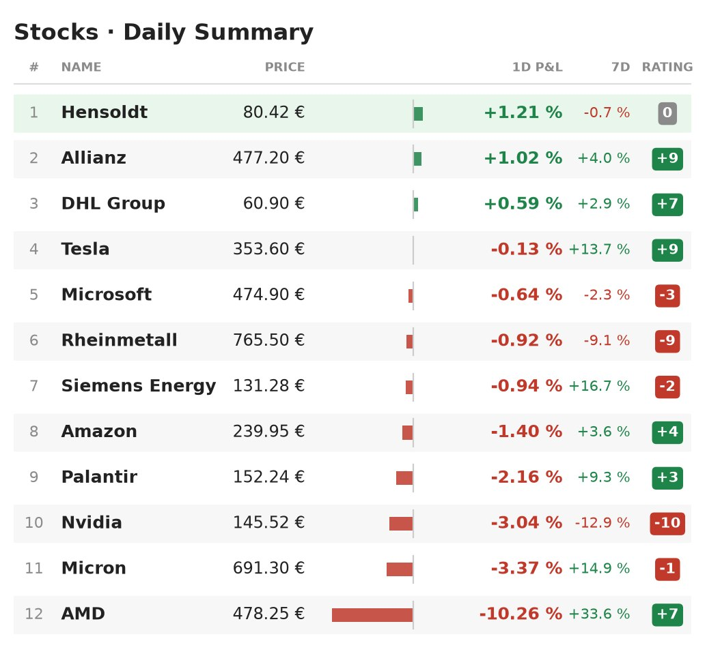

# Features

[← back to the README](../readme.md)

**Analysis**
- Crypto data from CoinGecko, stock data from Yahoo Finance; foreign currencies (USD, GBP, ...) are converted to EUR
- 250 daily / 450 hourly values are loaded, indicators are calculated on the full history and the last 100 values are evaluated
- Scoring system from RSI14, SMA7/VMA7, ROC5/VROC5 with volume support and fake-out detection, shown as an easy score 1–10 with reasons
- EMA 12/26 crossovers, Bollinger Bands (20,2), 7-day trend slope
- Support/resistance zones from pivot points of the full history (stocks: daily high/low, like on TradingView)
- Chart pattern detection: Double/Triple Top/Bottom and (Inverse) Head and Shoulders with neckline, target and invalidation level

**Alarms**
- Automatic hourly and daily analysis of all assets marked with `1` in `assets.ini`
- Triggers chosen by a backtest: strong 5-day rise, score above 8, EMA crossover downwards, chart pattern breakout
- Trend filter: buy alarms only above the 200-day average
- Buy alarms also for watched assets you do not own yet; sell alarms only for your portfolio
- Duplicate filter: the same alarm is not sent twice in a row

**Charts and Messages**
- Chart without weekend gaps: price with price tag, EMAs, Bollinger Bands, signals, support/resistance (R1/S1), chart pattern, volume bars and volume profile
- Clean Telegram messages (bold headers, aligned values)
- Daily ranking of all assets by 1-day P&L
- Daily P&L of your own positions (crypto and stocks together) after the summary: value, 1-day profit/loss in € and %, total profit/loss, total row
- P&L chart of the last 13 weeks as weekly bars: the realised profit/loss of your sales in each week (from `transactions.csv`, FIFO) in full colour, one part per sale (white line between them; gains upwards, losses downwards); for the current week also the unrealised price change of your open positions in light colour, one part per open asset (gains upwards, losses downwards). Values only for the realised parts. At the top the realised total of the 13 weeks, below it in brackets the unrealised gains and losses of this week, e.g. (+400.00 | −700.00) €

**Portfolio**
- Buys and sells in `transactions.csv` (FIFO bookkeeping)
- Profit/loss per asset, background colour of the chart shows profit or loss
- Holding period: amount held longer than one year (tax-relevant for crypto in Germany)

**Planning and Research**
- `/ai_prompt` creates a detailed prompt for ChatGPT or Claude: technical data, support/resistance with risk/reward, chart pattern, bottom/top formation, score 1–10, market phase of the asset and its leading market, your position and common investment rules – no AI API needed, just copy and paste
- With a Claude API key: `/ai_api_decision3s` answers directly with the decision in three sentences, `/ai_api_plan` with a trading plan that you save as plan alert with one tap
- Important dates (earnings, central bank meetings, ...) in `events.ini` or via `/event`: reminder one day before, plus daily analysis
- Trading plans in `planalert.ini` or via `/plan_alert`: buy zone, target and stop per asset; messages depend on whether you hold the asset, plus daily analysis
- Quarterly results: automatic reminder one day before for all stocks in the alarm analysis (date from Yahoo), plus daily analysis
