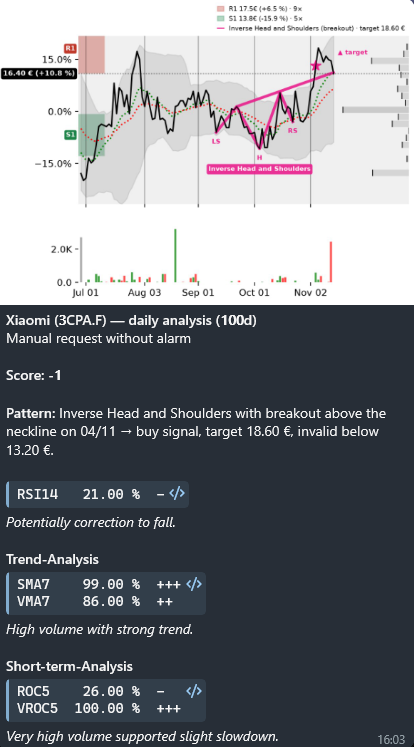

# CaSa – Crypto and Stock Alert

CaSa watches your cryptocurrencies and stocks, analyses them with technical indicators and sends alerts, charts and daily summaries to **Telegram**. The same Telegram chat is used to control the program: run analyses on demand, record buys and sells, switch alarms on and off, plan important dates and create prompts for ChatGPT or Claude.

## Contents

- [Why CaSa?](#why-casa)
- [Features](#features)
- [What's New](#whats-new)
- [Quick Start](#quick-start)
- [Telegram Commands](#telegram-commands)
- [Daily Schedule](#daily-schedule)
- [Understanding Alerts and Charts](#understanding-alerts-and-charts)
- [Configuration](#configuration)
- [Project Structure](#project-structure)
- [Known Limitations](#known-limitations)
- [Roadmap](#roadmap)
- [License, Disclaimer and Links](#license)

## Why CaSa?

Casa means “home” in Spanish. I’m saving to buy a place of my own, and I know a lot of people my age and younger who are working toward the same goal. With home prices as high as they are, I started thinking more seriously about how to build my savings over time. That’s what got me interested in investing.

As I looked into stocks and cryptocurrencies, one thing kept putting me off. I worried I’d miss a sudden price move, and the swings in crypto made the risk of losing money feel especially real. I wanted a way to keep up with the markets without feeling like I had to check them all day.

The apps I tried could tell me when a price crossed a threshold, but I wanted more control over which changes would trigger an alert. In the apps I found, that flexibility usually meant paying for a subscription. So I built the tool I wanted to use and named it CaSa after the goal that got me started.

CaSa is free and open source on GitHub. The core features are already in place, and the [roadmap](#roadmap) outlines what I’d like to build next. If you’ve run into the same frustrations, I’d love to hear what would make CaSa useful to you.


## Features

**Analysis**
- Crypto data from CoinGecko, stock data from Yahoo Finance; foreign currencies (USD, GBP, ...) are converted to EUR
- 250 daily / 450 hourly values are loaded, indicators are calculated on the full history and the last 100 values are evaluated
- Scoring system from RSI14, SMA7/VMA7, ROC5/VROC5 with volume support and fake-out detection, shown as an easy score 1–10 with reasons
- EMA 12/26 crossovers, Bollinger Bands (20,2), 7-day trend slope
- Support/resistance zones from pivot points of the full history (stocks: daily high/low, like on TradingView)
- Chart pattern detection: Double/Triple Top/Bottom and (Inverse) Head and Shoulders with neckline, target and invalidation level

**Alarms**
- Automatic hourly and daily analysis of all assets marked with `1` in `assets.ini`
- Triggers chosen by a backtest: strong 5-day rise, score above 8, EMA crossover downwards, chart pattern breakout
- Trend filter: buy alarms only above the 200-day average
- Buy alarms also for watched assets you do not own yet; sell alarms only for your portfolio
- Duplicate filter: the same alarm is not sent twice in a row

**Charts and Messages**
- Chart without weekend gaps: price with price tag, EMAs, Bollinger Bands, signals, support/resistance (R1/S1), chart pattern, volume bars and volume profile
- Clean Telegram messages (bold headers, aligned values)
- Daily ranking of all assets by 1-day P&L


**Portfolio**
- Buys and sells in `transactions.csv` (FIFO bookkeeping)
- Profit/loss per asset, background colour of the chart shows profit or loss
- Holding period: amount held longer than one year (tax-relevant for crypto in Germany)

**Planning and Research**
- `/ai` creates a detailed prompt for ChatGPT or Claude: technical data, support/resistance with risk/reward, chart pattern, bottom/top formation, score 1–10, market phase of the asset and its leading market, your position and common investment rules – no AI API needed, just copy and paste
- Important dates (earnings, central bank meetings, ...) in `events.ini` or via `/event`: reminder one day before, plus daily analysis
- Price alerts in `valuealert.ini` or via `/price_alert`: message with your note when a price reaches your mark, plus daily analysis
- Quarterly results: automatic reminder one day before for all stocks in the alarm analysis (date from Yahoo), plus daily analysis

## What's New

**Version 0.1.8** – all changes in [CHANGELOG.md](CHANGELOG.md)

- Easier messages: score 1–10 with traffic-light lines (🟢 🔴 🟡) and one figure block per line – long-term trend, risk/reward, RSI, trend, short-term, chart pattern
- Price alerts with `/price_alert`: message with your note when a price reaches your mark
- `/smart_alert` (formerly `/alarm`), delete dates with 🗑 in `/event`
- Start message with logo and recommended number of assets
- Clearer `logfile.txt`, errors of Telegram commands shown directly
- AI prompt with the same chart pattern, risk/reward and score as the message

**Version 0.1.7**

- After `/check` the bot asks whether an AI prompt should be created – one tap instead of a second command

**Version 0.1.6**

- Buy alarms also for watched assets you do not own yet
- Reminder one day before every date in `events.ini`
- Optional free CoinGecko demo key for more cryptos or several instances
- One error message per analysis instead of a flood of messages when a data source blocks
- [Roadmap](#roadmap) with planned features

**Version 0.1.5**

- Chart pattern detection (Double/Triple Top/Bottom, Head and Shoulders): drawn in pink, explained in plain language in every message, own breakout alarm
- Alarms reworked after a backtest with 9 assets over 7–14 years: new Score>8 alarm, SMA200 trend filter, weak alarms removed – far fewer but better alarms
- Reminder one day before quarterly results, with daily analysis
- Charts: current price tag, R1/S1 as tags on the left; stock prices and zones like on TradingView
- Shorter AI prompt that fits into one Telegram message

**Version 0.1.0**

- Telegram bot instead of Pushover: notifications, charts and commands in one chat
- Redesigned charts (trading-day axis, 200 dpi, volume profile, support/resistance) and daily ranking image
- New commands: `/check` and `/ai` with buttons, `/alarm`, `/sellall`, `/event`
- `assets.ini` replaces the old watchlist; `; 1` marks assets for the alarm analysis
- AI prompt with bottom/top formation and market phase (SMA50/SMA200, Golden/Death Cross)
- Event reminders with automatic daily analysis
- Bug fixes: no duplicate daily crypto alarms, price no longer cut off at Bollinger breakouts, evening summary kept after `/buy` / `/sell`

## Quick Start

1. **Install Python 3** (tested with Python 3.13)
2. **Install the dependencies**
   - Windows: run `install_venv.bat` (creates `.venv` and installs `requirements.txt`)
   - Linux/macOS: `python3 -m venv .venv` and `.venv/bin/pip install -r requirements.txt`
3. **Create a Telegram bot**
   - Send `/newbot` to [@BotFather](https://t.me/BotFather) and copy the token
   - Send any message to your new bot, then open `https://api.telegram.org/bot<TOKEN>/getUpdates` – the number at `"chat":{"id":...}` is your chat id
4. **Create `config.ini` and `assets.ini`** in the program folder (see [Configuration](#configuration))
5. **Start CaSa**: `python main.py` (Windows: `.venv\Scripts\python main.py`)

After the start, the bot sends the CaSa logo with a short message: the version, the number of monitored assets and the next scheduled analysis. Send `/help` for all commands.

**Tested on**: RockPi3 with Armbian OS and Windows 11.

## Telegram Commands

| Command | Function |
|---|---|
| **Analysis** | |
| `/check` | Daily analysis of one asset without alarm (choose via buttons or `/check <symbol> <crypto\|stock>`); afterwards a question whether an AI prompt (`/ai`) should be created |
| `/ai` | AI prompt to copy into ChatGPT or Claude (buttons or `/ai <symbol>`) |
| `/analyse <daily\|hourly\|summary>` | Start an analysis immediately |
| **Alarms and Dates** | |
| `/smart_alert` | Switch assets on/off for the alarm analysis (buttons or `/smart_alert <symbol> <on\|off>`); the old `/alarm` still works |
| `/event` | List upcoming dates with a 🗑 button to delete each one (with confirmation), or add one: `/event <symbol> <DD/MM/YYYY> <text>` |
| `/price_alert` | List price alerts with a 🗑 button to delete each one (with confirmation), or add one: `/price_alert <symbol> <price> <note>` (below/above is detected from the current price, or add it: `/price_alert APC.DE below 320.82 ...`) |
| **Portfolio** | |
| `/buy <symbol> <crypto\|stock> <amount €> <qty> <DD/MM/YYYY>` | Record a buy |
| `/sell <symbol> <crypto\|stock> <amount €> <qty>` | Record a sell (today) |
| `/sellall <symbol> [amount €]` | Record the sale of the full position (current price if no amount, confirmation required) |
| `/history <symbol>` | Transactions of one asset |
| `/transactions` | All transactions |
| **System** | |
| `/status` | Bot status and number of transactions |
| `/restart` | Restart the main program (reloads all files; after a program update stop and start CaSa completely) |
| `/help` | Overview of all commands |

Only messages from the chat id in `config.ini` are accepted.

## Daily Schedule

| Time | What happens |
|---|---|
| every hour | 100-hour analysis of all crypto assets with `1` |
| 08:00 | Reminder for tomorrow's dates from `events.ini` and tomorrow's quarterly results (stocks with `1`), each plus daily analysis of the asset |
| every hour | Price alerts from `valuealert.ini` (stocks Monday to Friday, 08:00–22:00) |
| 09:30 and 12:30 | 100-day analysis of all assets with `1` (stocks Monday to Friday, 08:00–22:00) |
| 18:30 | Daily ranking (crypto and stocks) |

If the program is started after 12:30, the daily analysis runs immediately; missed date reminders are sent at the start. With `test_mode = 1` there is no schedule – all analyses run once at the start (date reminders still work).

## Understanding Alerts and Charts

**Alarm triggers**

| Trigger | Signal | Meaning |
|---|---|---|
| Positive-5 | Buy | 5-period rate of change rises above `seven_day_price_change` (first value above it); only above the SMA200 |
| Score>8 | Buy | Internal score (-18 to +18) rises above 8 for the first time (daily only); only above the SMA200 |
| Cross-EMA | Sell | Fast EMA (12) crosses the slow EMA (26) downwards (daily only) |
| Pattern-Breakout | Buy / Sell | Fresh close through the neckline of a chart pattern: Double/Triple Bottom or Inverse Head and Shoulders (buy), Double/Triple Top or Head and Shoulders (sell); never marked as important |

Buy alarms are sent for all assets with `1` in `assets.ini`, also for watched assets you do not own yet (marked in the message). Sell alarms are only sent for assets you own. Messages with a score above +5 (buy) or below -5 (sell) are marked as important.

The selection is based on a backtest with 9 assets (Bitcoin, Ethereum, DAX and six stocks, 7–14 years of daily data): Cross-EMA Buy, Negative-5 and 100-Minimum/-Maximum showed no advantage over an average day and were removed. Positive-5 only works with a high threshold (about 10 %); the score was the strongest signal. Both buy alarms only worked in an uptrend (price above the 200-day average), so they are filtered by it. SMA200 breakout and golden cross were also tested as separate alarms, but added little beyond the existing ones.

**Message content**



- **Score 1–10**: today's rating compared with the last 100 days of the same asset (10 = among the strongest 10 %), followed by one traffic-light line per analysis (🟢 good, 🔴 bad, 🟡 neutral or not yet clear) in the same order as the blocks below: **Long-term-Analysis** (price vs. 200-day average), **Risk/Reward-Analysis** (ℹ️ information only: room to resistance R1 and distance to support S1 for stop and target; in the backtest a "good" ratio did not lead to better results), **RSI-Analysis** (real RSI value: below 30 oversold, above 70 overbought), **Trend-Analysis**, **Short-term-Analysis** and **Pattern-Analysis**. Each block below shows the figures behind its line. Internally CaSa still calculates a score from -18 to +18 (used for the Score>8 alarm and the AI prompt).
- **Pattern-Analysis**: in the confirmation only a short status (buy signal, sell signal, not a signal yet, none detected); below it as its own block the detected chart pattern in one sentence (forming or breakout, price that triggers the signal, target, invalidation level); drawn in pink in the chart
- **RSI14**, **SMA7**, **VMA7**, **ROC5**, **VROC5** in the blocks: the real value first (RSI, 7-day average in €, average volume, 5-day change in %), in brackets its position within the last 100 values (e.g. 88 % = higher than on 88 % of the days), then the signal strength
- **Amount >1 year**: holdings older than one year

| Symbol | Signal strength |
|---|---|
| `+++` / `---` | very strong (top/bottom 10 %) |
| `++` / `--` | strong (10–20 %) |
| `+` / `-` | moderate (20–30 %) |
| `●` | neutral (30–70 %) |

*Fake-out*: the price moves, but volume does not support the move.

**Chart**
- Black line: price; dotted lines: fast/slow EMA; grey band: Bollinger Bands
- Triangles: EMA crossovers; dots: 100-day high/low of the fast EMA (hidden when a chart pattern is drawn)
- **R1 / S1**: nearest resistance above and support below the price, as a short band at the left edge with a tag outside the chart (stronger colour = at least 2 touches; ▲/▼ = zone outside the visible range); details in the legend at the top right
- **Chart pattern** (pink): pattern line with labels, neckline, star at the breakout and target
- Black tag on the left: current price and its deviation in %
- Grey bars on the right: volume profile of the visible range (darker bar = price level with most volume)
- Left axis: deviation in % from your average buy price (or from the average price if you don't own the asset)
- Background green/red: price above/below your average buy price

## Configuration

All files are plain text and can be edited with any editor. After changes, send `/restart`.

### config.ini

```ini
[telegram]
token = YOUR_TELEGRAM_BOT_TOKEN
chat_id = YOUR_CHAT_ID

[alarm]
seven_day_price_change = 10     # threshold for the Positive-5 alarm (%), 10 recommended by the backtest
previous_alarm_change = 3       # minimum change before the same alarm is sent again
one_day_price_change = 10       # currently not used
one_day_profit_limit = -2       # currently not used
test_mode = 0                   # 0 = scheduled analyses, 1 = run all analyses once at start

[coingecko]
# optional: free demo key from coingecko.com/en/developers/dashboard (empty = free public access)
api_key =
```

**CoinGecko key (optional):** if `api_key` is set, CaSa uses it; otherwise the free public access. With a key, the limit (30 requests per minute, 10,000 per month) applies per key instead of per internet connection – useful for more cryptos or several CaSa instances on one network.

### assets.ini

All assets known to the program. Crypto symbols are CoinGecko IDs, stock symbols are Yahoo Finance symbols.

```ini
# Format: symbol = Name; crypto|stock; 1
# 1 at the end = part of the automatic alarm analysis
# without 1    = only available for /check and /ai
# # at the start hides the entry completely

[crypto]
bitcoin        = Bitcoin; crypto; 1
cardano        = Cardano; crypto

[stocks]
NVD.DE         = Nvidia; stock; 1
APC.DE         = Apple; stock
```

The `1` can also be switched in Telegram with `/smart_alert`.

**How many assets with `1`?** The free APIs limit the requests:
- **Crypto (CoinGecko): at most about 8, with own key about 12.** Each coin needs about 26 requests a day (hourly analysis); more coins cause "too many requests" errors.
- **Stocks (Yahoo): 30–40 are fine.** About 3 requests per stock and day – the real limit is the number of alarms.
- Prefer liquid listings in EUR (e.g. Xetra `.DE`): no exchange rate request, reliable volume.
- The start message shows how many are in use, e.g. `6/12 crypto, 12/30 stocks`, and warns when there are more than recommended.

### events.ini (optional)

```ini
# Format: name = symbol; DD/MM/YYYY; description
[events]
nvda_20261117  = NVD.DE; 17/11/2026; Q3 earnings after US market close
```

Entries can also be added with `/event` and deleted via the 🗑 buttons in the `/event` list. The reminder comes at 08:00 one day before. Past dates are ignored.

### valuealert.ini (optional)

Price alerts: a message as soon as a price reaches your mark – for example the entry price of an AI analysis ("I'd wait for a pullback toward €320.82").

```ini
# Format: name = symbol; below|above; price in EUR; note
[alerts]
apc_de_below_320_82  = APC.DE; below; 320.82; Wait for pullback, buy small amount
```

`below` = the price falls to the mark or lower, `above` = it rises to the mark or higher. The file is created automatically with the first `/price_alert`. Alerts are checked every hour (stocks Monday to Friday, 08:00–22:00). When the mark is reached you get your note plus the daily analysis, and the alert is removed.

### transactions.csv

Written by `/buy`, `/sell` and `/sellall`:

```
type;symbol;name;action;amount;qty;date
crypto;bitcoin;Bitcoin;buy;500.0;0.01;01/01/2024
stock;QCOM;Qualcomm;sell;312.16;2.0;14/11/2026
```

### ai_prompt.txt

Template for the `/ai` prompt. It is created automatically on first use and can be edited freely. Placeholders in curly brackets such as `{name}`, `{price}`, `{support}`, `{bottom}` or `{market}` are filled in by the program.

### logfile.txt

Written by the program for error analysis and monitoring – one line per event:

```text
2026-11-15 16:39:59  WARN   CoinGecko ripple: too many requests (attempt 1/5), waiting 60 s
2026-11-15 16:40:12  INFO   Analysis crypto 100d done: 6/6 ok, 1 alarms, 0 failed, 23 s
2026-11-15 16:41:02  ERROR  Analysis NVD.DE (100d) failed: no data received after 5 attempts
```

`ERROR` = something failed, `WARN` = problem, the program continues, `INFO` = status (analyses, sent messages as one line). Errors include the full details below the line. Above 1 MB the file is renamed to `logfile.old.txt` and a new log starts.

`config.ini`, `assets.ini`, `events.ini`, `valuealert.ini`, `transactions.csv` and the log files contain personal data and are excluded from Git via `.gitignore`.

## Project Structure

| File | Purpose |
|---|---|
| `main.py` | Main program: loads the files, schedules analyses, handles commands from the bot |
| `classes.py` | `CryptoStock` class (data, transactions, analysis per asset), reading and writing `assets.ini`, `events.ini`, `transactions.csv` |
| `func.py` | Data retrieval, indicators, support/resistance, bottom/top formation, market phase, alarms, charts, summary image |
| `telegram_bot.py` | Telegram bot, runs as a separate process: sends messages, forwards commands to `main.py` |
| `install_venv.bat` | Installation on Windows |
| `requirements.txt` | Python packages |

## Known Limitations

- The free CoinGecko API has rate limits and no daily candles (open/high/low); crypto analysis uses closing prices only.
- The hourly analysis is only scheduled for crypto; stocks are analysed daily.
- `/restart` reloads the files (config, assets, dates, transactions), but not the program code. After an update (new version), stop CaSa and start it again.
- The program remembers sent alarms and date reminders only while it is running; after a full restart (not `/restart`), an alarm or reminder of the same day can be sent again.
- Quarterly results dates come from Yahoo. Right after a report Yahoo often does not know the next date yet; it is picked up automatically as soon as it is announced. Some stocks (e.g. BAE Systems) have no date on Yahoo.
- While an analysis is running, Telegram commands are processed afterwards.

## Roadmap

### Usability
- [ ] **One-line summary** at the top of every message, e.g. "🟢 Uptrend, strong buying interest – buy signal". The details follow below for anyone who wants them.
- [x] **Easier score**: The −18…+18 score was hard to read. Now a score 1–10 with the assessments as traffic-light confirmation (🟢 🔴 🟡).
- [ ] **Simpler score blocks**: Indicator lines such as RSI14 or SMA7 explained in plain language for non-experts.
- [ ] **`/explain` command**: Explains terms like RSI, SMA200 or neckline in two sentences.

### Setup
- [ ] **Docker image**: Simple deployment. Private files (config, portfolio) move to a separate data folder so they stay outside the image.
- [ ] **Setup wizard in Telegram**: New users add assets and settings via chat instead of editing INI files.
- [ ] **Disclaimer** in README and start message: CaSa provides technical signals only, no investment advice.

### Backtesting
- [ ] **Backtest script in the repo**: The backtest currently lives in a temporary folder. In the repo, every rule change can be checked against historical data.
- [ ] **Hit rate in alarm messages**, e.g. "This alarm was right in 61 % of cases (backtest)". Helps users judge how reliable a signal is.
- [ ] **Sideways market detection (ADX)**: Today only up- and downtrends are detected (SMA50/SMA200). ADX adds a sideways phase, in which many trend signals fail.

### Indicators & charts
- [ ] **ATR-based stop-loss suggestion**, e.g. "Stop around 142 € (2× ATR)". Adapts the stop to how much the asset usually moves.
- [ ] **Relative strength vs. index**: Strong stocks in strong markets, e.g. "Nvidia +12 % vs. Nasdaq in 3 months". One of the most robust rules in technical analysis.
- [ ] **R2/S2 zones**: A second resistance and support zone, plus an alarm when the price breaks through a zone.
- [ ] **More chart patterns**: Triangles, wedges and flags in addition to the existing patterns.
- [ ] **Fair Value Gaps**: Price gaps between candles that the price may return to. Popular but unproven, so they are tested in the backtest before any alarm is added.

### Alerts & events
- [x] **Own price alarms**, e.g. `/price_alert NVD.DE below 130`. User-defined price levels, independent of the indicators.
- [ ] **Options expiry and market holidays**: The major expiry date (third Friday of March, June, September and December) is calculated automatically. Exchange holidays come from a fixed list.
- [ ] **Crypto events**: Known dates such as Bitcoin halvings in `events.ini`.
- [ ] **Automatic import of economic dates**: Fed, CPI and ECB dates without manual entry. Needs a calendar source.
- [x] **Delete dates directly in Telegram**: Remove entries from `events.ini` via chat.

### Data & sentiment
- [ ] **Fear & Greed index** as a sentiment line in the daily summary. Free for crypto (alternative.me), for stocks only via an unofficial CNN source.
- [ ] **Google Trends**: Search interest as a sentiment indicator, especially for crypto. `pytrends` and a `google_trends` function already exist but are not used yet.
- [ ] **Alarm for unusual news volume**: Triggers when an asset gets far more news than usual (source: yfinance `Ticker.news`). It shows that something is happening, not in which direction.
- [ ] **Insider trades**: Purchases and sales by executives from free official sources: SEC EDGAR (Form 4) for US stocks, Directors' Dealings for German stocks. Large insider purchases are a documented signal.
- [ ] **Regulatory news via RSS**: Press releases from SEC and BaFin, flagged when an asset from the watchlist is mentioned.

### Portfolio
- [ ] **Read-only exchange API for crypto (ccxt)**: Loads holdings directly from the major exchanges. Read-only keys only, never with trading rights.
- [ ] **Total value and daily P&L** in the evening summary.
- [ ] **Position size suggestion**: Based on ATR, e.g. max. 2 % of the portfolio at risk per position.
- [ ] **Tax-free reminder**: A message on the day a crypto position has been held for more than one year (tax-free under German law).

### Reliability
- [ ] **Keep known alarms after a full restart**: They are currently lost, so the same alarm can be sent twice.
- [ ] **Health check**: A daily "I'm alive" line, or a warning when an analysis keeps failing.
- [ ] **Automated tests** for alarms and charts, so changes don't break existing behaviour.

### Not planned
- **Opening/closing volatility**: Needs minute data, while CaSa works with daily data.
- **X/Twitter tracking**: The API is expensive and the posts are hard to evaluate.

## Versioning

CaSa uses [Semantic Versioning](https://semver.org/) (`MAJOR.MINOR.PATCH`). The version is set in `main.py` (`VERSION`) and shown in the start message; each release is tagged in Git (e.g. `v0.1.8`). Changes are listed in [CHANGELOG.md](CHANGELOG.md).

## License

This project is licensed under the MIT License.

## Disclaimer

This application generates alerts based on technical indicators and market data analysis. All alerts are purely informational and require independent user evaluation. Users are solely responsible for their own investment decisions. CaSa does not recommend buying or selling any assets, nor does it provide personalized investment advice. Answers of AI tools to the `/ai` prompt are not investment advice either.

## Links

- [Telegram BotFather](https://t.me/BotFather) — create a Telegram bot
- [CoinGecko](https://www.coingecko.com) — cryptocurrency market data
- [Yahoo Finance](https://finance.yahoo.com) — stock market data
- [Rock Pi](https://rockpi.org/) — single-board computer for hosting
- [Armbian OS](https://www.armbian.com/) — lightweight ARM-based OS
