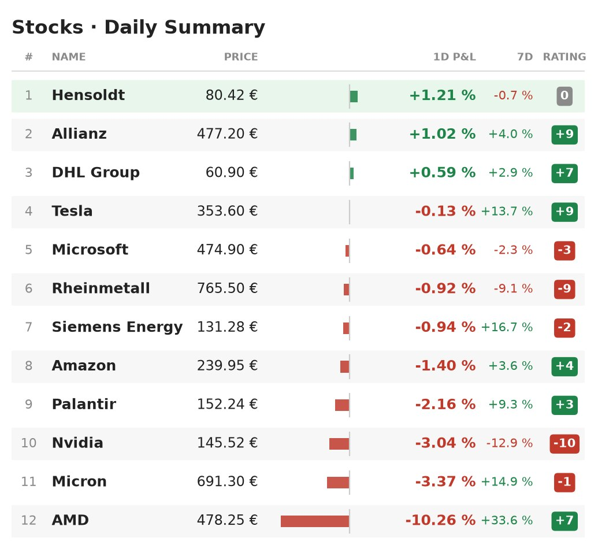

# CaSa – Crypto and Stock Alert

CaSa watches your cryptocurrencies and stocks, analyses them with technical indicators and sends alerts, charts and daily summaries to **Telegram**. The same Telegram chat is used to control the program: run analyses on demand, record buys and sells, switch alarms on and off, plan important dates and create prompts for ChatGPT or Claude.

## Contents

- [Why CaSa?](#why-casa)
- [In a Nutshell](#in-a-nutshell) – what CaSa does, setup in four steps, everyday use
- [Details for Experts](#details-for-experts) – for the curious and experts:
  - [Features](#features)
  - [What's New](#whats-new)
  - [Documentation](#documentation) – installation, commands, alerts and charts, configuration
  - [Project Structure](#project-structure)
  - [Known Limitations](#known-limitations)
  - [Roadmap](#roadmap)
  - [License, Disclaimer and Links](#license)

## Why CaSa?

Casa means “house” or “home” in Spanish. I’m saving to buy a place of my own, and I know many people my age and younger who are trying to do the same. With home prices so high, I started asking myself what I could do today to get a little closer to that goal. That question led me to investing.

As I started learning about stocks and cryptocurrencies, I kept wondering what might happen while I was away from the screen. Crypto prices could change quickly, and I worried about how much I could lose. I wanted a way to follow the markets without checking prices all day. The apps I tried could tell me when a price reached a certain level, but I wanted more control over when I got an alert. That usually meant paying for a subscription. So I built the tool I wanted to use and called it CaSa, after the goal that got me started.

CaSa is free and open source on GitHub. It uses very little computing power, so it can run on a low-cost computer without a cloud server or paid API subscriptions. It explains what you’re seeing in simple words, even if you’re new to investing. I started CaSa with a home of my own in mind. But now I hope it helps others take their first steps in investing, whatever they’re saving for. If you try it, I’d love to hear what would make it more useful to you. You can see what I’m planning next in the [roadmap](https://github.com/TheRealDeluxee/CryptoStockManager#roadmap).

## In a Nutshell

### What CaSa does

- **Watches your stocks and cryptos** day and night – you don't have to look at prices all day.
- **Messages you in Telegram** when something important happens, with a chart and a simple score from 1 to 10.
- **Explains in plain words** what is going on – no expert knowledge needed.
- **Knows your portfolio**: what you bought, what you sold, and your profit or loss every evening.
- **Follows your own plan**: set a buy price, a target and a stop for an asset – CaSa tells you when it is reached.
- **Optional AI**: one tap asks Claude for a second opinion.

CaSa gives signals, not investment advice. You decide.

### What you need

- A **Raspberry Pi** 4 or 5 (a small, cheap computer), a microSD card and internet
- **Telegram** on your phone

### Set up in four steps

1. **Create your Telegram bot**: in Telegram, send `/newbot` to [@BotFather](https://t.me/BotFather) and copy the token it gives you.
2. **Write the CaSa image** to the microSD card with the free [Raspberry Pi Imager](https://www.raspberrypi.com/software/).
3. **Start the Pi and log in once** from your PC – a short setup asks for your bot.
4. **Done.** CaSa runs by itself from now on, also after a power cut.

The step-by-step guide: [Option A: CaSa Image for the Raspberry Pi](docs/installation.md#option-a-casa-image-for-the-raspberry-pi-recommended).

### Everyday use – all in Telegram

| You want to … | Send |
|---|---|
| look at one stock or crypto now | `/check` |
| choose which assets CaSa watches for you | `/smart_alert` |
| get a reminder before an important date | `/event` |
| set a plan for an asset (buy price, target, stop) | `/plan_alert` |
| record a buy or a sale | `/record` |

Below every alert you find buttons for the next step – for example to record a buy or to ask the AI.

 

---
---

 

## Details for Experts

> [!CAUTION]
> **You don't need this part to use CaSa.** Everything below is for the curious and for experts: how CaSa analyses, what every setting does, how to install it without the image, and what is planned next.

## Features

**Analysis**
- Crypto data from CoinGecko, stock data from Yahoo Finance; foreign currencies (USD, GBP, ...) are converted to EUR
- 250 daily / 450 hourly values are loaded, indicators are calculated on the full history and the last 100 values are evaluated
- Scoring system from RSI14, SMA7/VMA7, ROC5/VROC5 with volume support and fake-out detection, shown as an easy score 1–10 with reasons
- EMA 12/26 crossovers, Bollinger Bands (20,2), 7-day trend slope
- Support/resistance zones from pivot points of the full history (stocks: daily high/low, like on TradingView)
- Chart pattern detection: Double/Triple Top/Bottom and (Inverse) Head and Shoulders with neckline, target and invalidation level

**Alarms**
- Automatic hourly and daily analysis of all assets marked with `1` in `assets.ini`
- Triggers chosen by a backtest: strong 5-day rise, score above 8, EMA crossover downwards, chart pattern breakout
- Trend filter: buy alarms only above the 200-day average
- Buy alarms also for watched assets you do not own yet; sell alarms only for your portfolio
- Duplicate filter: the same alarm is not sent twice in a row

**Charts and Messages**
- Chart without weekend gaps: price with price tag, EMAs, Bollinger Bands, signals, support/resistance (R1/S1), chart pattern, volume bars and volume profile
- Clean Telegram messages (bold headers, aligned values)
- Daily ranking of all assets by 1-day P&L
- Daily P&L of your own positions (crypto and stocks together) after the summary: value, 1-day profit/loss in € and %, total profit/loss, total row
- P&L chart of the last 13 weeks as weekly bars: the realised profit/loss of your sales in each week (from `transactions.csv`, FIFO) in full colour, one part per sale (white line between them; gains upwards, losses downwards); for the current week also the unrealised price change of your open positions in light colour, one part per open asset (gains upwards, losses downwards). Values only for the realised parts. At the top the realised total of the 13 weeks, below it in brackets the unrealised gains and losses of this week, e.g. (+400.00 | −700.00) €

**Portfolio**
- Buys and sells in `transactions.csv` (FIFO bookkeeping)
- Profit/loss per asset, background colour of the chart shows profit or loss
- Holding period: amount held longer than one year (tax-relevant for crypto in Germany)

**Planning and Research**
- `/ai_prompt` creates a detailed prompt for ChatGPT or Claude: technical data, support/resistance with risk/reward, chart pattern, bottom/top formation, score 1–10, market phase of the asset and its leading market, your position and common investment rules – no AI API needed, just copy and paste
- With a Claude API key: `/ai_api_decision3s` answers directly with the decision in three sentences, `/ai_api_plan` with a trading plan that you save as plan alert with one tap
- Important dates (earnings, central bank meetings, ...) in `events.ini` or via `/event`: reminder one day before, plus daily analysis
- Trading plans in `planalert.ini` or via `/plan_alert`: buy zone, target and stop per asset; messages depend on whether you hold the asset, plus daily analysis
- Quarterly results: automatic reminder one day before for all stocks in the alarm analysis (date from Yahoo), plus daily analysis

## What's New

**Version 0.1.13** – all changes in [CHANGELOG.md](CHANGELOG.md)

- CaSa image for the Raspberry Pi: write it with the Raspberry Pi Imager, log in once, a wizard asks for keyboard, network drive (optional) and keys; CaSa runs as service and starts by itself
- Updates in Telegram: `/update` and a daily check with **⬆ Update now**, confirmed with "Update complete"
- Plan and date alerts like the alarms with chart and buttons (Record buy/sell, Delete plan); `/plan_alert` with guided Add plan
- 13-week P&L chart: realised gains and losses per sale, this week also unrealised per open asset
- `infos_for`: infos only for assets you hold (also in `/smart_alert_config`)

Earlier versions: [CHANGELOG.md](CHANGELOG.md)

## Documentation

| Page | Content |
|---|---|
| [Installation](docs/installation.md) | Option A: CaSa image for the Raspberry Pi (hardware, step by step, daily use, build the image) · Option B: Quick Start on your own computer |
| [Telegram commands](docs/commands.md) | Every command with its options |
| [Understanding alerts and charts](docs/alerts.md) | When CaSa sends what, score 1–10, traffic lights, figure blocks, chart, alarms and infos with their backtest results |
| [Configuration](docs/configuration.md) | `config.ini`, `assets.ini`, `events.ini`, `planalert.ini`, `transactions.csv`, AI prompt, alarm journal, `logfile.txt` |
| [Changelog](CHANGELOG.md) | All changes of every version |

## Project Structure

| File | Purpose |
|---|---|
| `main.py` | Main program: loads the files, schedules analyses, handles commands from the bot |
| `classes.py` | `CryptoStock` class (data, transactions, analysis per asset), reading and writing `assets.ini`, `events.ini`, `transactions.csv` |
| `func.py` | Data retrieval, indicators, support/resistance, bottom/top formation, market phase, alarms, charts, summary image |
| `telegram_bot.py` | Telegram bot, runs as a separate process: sends messages, forwards commands to `main.py` |
| `install_venv.bat` | Installation on Windows |
| `image/` | Building the CaSa image for the Raspberry Pi (pi-gen) |
| `docs/` | Documentation pages and images of this README |
| `requirements.txt` | Python packages |

## Known Limitations

- The free CoinGecko API has rate limits and no daily candles (open/high/low); crypto analysis uses closing prices only.
- The hourly analysis is only scheduled for crypto; stocks are analysed daily.
- `/restart` reloads the files (config, assets, dates, transactions), but not the program code. After an update (new version), stop CaSa and start it again.
- The program remembers sent alarms and date reminders only while it is running; after a full restart (not `/restart`), an alarm or reminder of the same day can be sent again.
- Quarterly results dates come from Yahoo. Right after a report Yahoo often does not know the next date yet; it is picked up automatically as soon as it is announced. Some stocks (e.g. BAE Systems) have no date on Yahoo.
- While an analysis is running, Telegram commands are processed afterwards.

## Roadmap

### Usability
- [ ] **One-line summary** at the top of every message, e.g. "🟢 Uptrend, strong buying interest – buy signal". The details follow below for anyone who wants them.
- [x] **Easier score**: The −18…+18 score was hard to read. Now a score 1–10 with the assessments as traffic-light confirmation (🟢 🔴 🟡).
- [ ] **Simpler score blocks**: Indicator lines such as RSI14 or SMA7 explained in plain language for non-experts.
- [ ] **`/explain` command**: Explains terms like RSI, SMA200 or neckline in two sentences.

### Setup
- [ ] **Docker image**: Simple deployment. Private files (config, portfolio) move to a separate data folder so they stay outside the image.
- [ ] **Setup wizard in Telegram**: New users add assets and settings via chat instead of editing INI files.
- [ ] **Disclaimer** in README and start message: CaSa provides technical signals only, no investment advice.

### Backtesting
- [ ] **Backtest script in the repo**: The backtest currently lives in a temporary folder. In the repo, every rule change can be checked against historical data.
- [ ] **Hit rate in alarm messages**, e.g. "This alarm was right in 61 % of cases (backtest)". Helps users judge how reliable a signal is.
- [ ] **Sideways market detection (ADX)**: Today only up- and downtrends are detected (SMA50/SMA200). ADX adds a sideways phase, in which many trend signals fail.

### Indicators & charts
- [ ] **ATR-based stop-loss suggestion**, e.g. "Stop around 142 € (2× ATR)". Adapts the stop to how much the asset usually moves.
- [ ] **Relative strength vs. index**: Strong stocks in strong markets, e.g. "Nvidia +12 % vs. Nasdaq in 3 months". One of the most robust rules in technical analysis.
- [ ] **R2/S2 zones**: A second resistance and support zone, plus an alarm when the price breaks through a zone.
- [ ] **More chart patterns**: Triangles, wedges and flags in addition to the existing patterns.
- [ ] **Fair Value Gaps**: Price gaps between candles that the price may return to. Popular but unproven, so they are tested in the backtest before any alarm is added.

### Alerts & events
- [x] **Own price alarms**, e.g. `/price_alert NVD.DE below 130`. User-defined price levels, independent of the indicators.
- [x] **Simple trading plans** (`planalert.ini`, `/plan_alert`): buy zone, target and stop per asset.
- [ ] **Plan conditions**: higher low, close above the first rebound high, above EMA12/SMA200; the AI prompt writes a ready plan line.
- [ ] **Options expiry and market holidays**: The major expiry date (third Friday of March, June, September and December) is calculated automatically. Exchange holidays come from a fixed list.
- [ ] **Crypto events**: Known dates such as Bitcoin halvings in `events.ini`.
- [ ] **Automatic import of economic dates**: Fed, CPI and ECB dates without manual entry. Needs a calendar source.
- [x] **Delete dates directly in Telegram**: Remove entries from `events.ini` via chat.

### Data & sentiment
- [ ] **Fear & Greed index** as a sentiment line in the daily summary. Free for crypto (alternative.me), for stocks only via an unofficial CNN source.
- [ ] **Google Trends**: Search interest as a sentiment indicator, especially for crypto. A `google_trends` function already exists but is not used yet; `pytrends` is no longer installed by default (`python -m pip install pytrends`).
- [ ] **Alarm for unusual news volume**: Triggers when an asset gets far more news than usual (source: yfinance `Ticker.news`). It shows that something is happening, not in which direction.
- [ ] **Insider trades**: Purchases and sales by executives from free official sources: SEC EDGAR (Form 4) for US stocks, Directors' Dealings for German stocks. Large insider purchases are a documented signal.
- [ ] **Regulatory news via RSS**: Press releases from SEC and BaFin, flagged when an asset from the watchlist is mentioned.

### Portfolio
- [ ] **Read-only exchange API for crypto (ccxt)**: Loads holdings directly from the major exchanges. Read-only keys only, never with trading rights.
- [x] **Total value and daily P&L** in the evening summary.
- [ ] **Position size suggestion**: Based on ATR, e.g. max. 2 % of the portfolio at risk per position.
- [ ] **Tax-free reminder**: A message on the day a crypto position has been held for more than one year (tax-free under German law).

### Reliability
- [ ] **Keep known alarms after a full restart**: They are currently lost, so the same alarm can be sent twice.
- [x] **Health check**: A status line in the log every 6 hours, with a warning when an analysis is overdue or failing.

### Not planned
- **Opening/closing volatility**: Needs minute data, while CaSa works with daily data.
- **X/Twitter tracking**: The API is expensive and the posts are hard to evaluate.

## Versioning

CaSa uses [Semantic Versioning](https://semver.org/) (`MAJOR.MINOR.PATCH`). The version is set in `main.py` (`VERSION`) and shown in the start message; each release is tagged in Git (e.g. `v0.1.10`). Changes are listed in [CHANGELOG.md](CHANGELOG.md).

## License

This project is licensed under the MIT License.

## Disclaimer

This application generates alerts based on technical indicators and market data analysis. All alerts are purely informational and require independent user evaluation. Users are solely responsible for their own investment decisions. CaSa does not recommend buying or selling any assets, nor does it provide personalized investment advice. Answers of AI tools to the `/ai_prompt` prompt, `/ai_api_decision3s` and `/ai_api_plan` are not investment advice either.

## Links

- [Telegram BotFather](https://t.me/BotFather) — create a Telegram bot
- [CoinGecko](https://www.coingecko.com) — cryptocurrency market data
- [Yahoo Finance](https://finance.yahoo.com) — stock market data
- [Rock Pi](https://rockpi.org/) — single-board computer for hosting
- [Armbian OS](https://www.armbian.com/) — lightweight ARM-based OS
