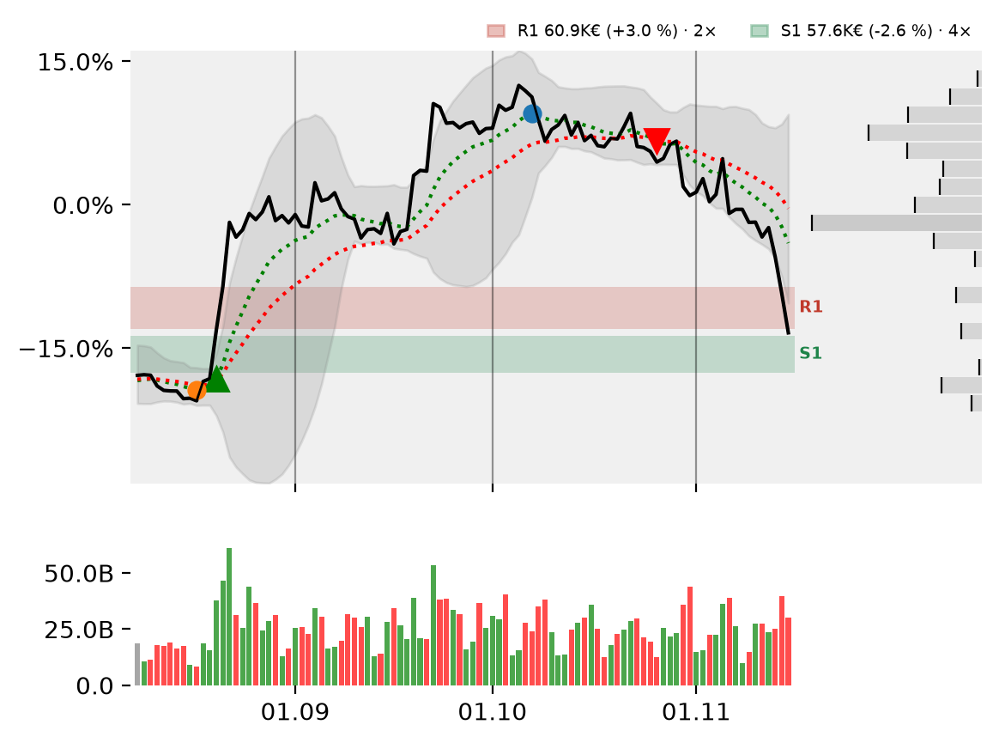

# CaSa – Crypto and Stock Alert

CaSa watches your cryptocurrencies and stocks, analyses them with technical indicators and sends alerts, charts and daily summaries to **Telegram**. The same Telegram chat is used to control the program: run analyses on demand, record buys and sells, switch alarms on and off, plan important dates and create prompts for ChatGPT or Claude.



## Contents

- [Why CaSa?](#why-casa)
- [Features](#features)
- [What's New](#whats-new)
- [Quick Start](#quick-start)
- [Telegram Commands](#telegram-commands)
- [Daily Schedule](#daily-schedule)
- [Understanding Alerts and Charts](#understanding-alerts-and-charts)
- [Configuration](#configuration)
- [Project Structure](#project-structure)
- [Known Limitations](#known-limitations)
- [Ideas for the Future](#ideas-for-the-future)
- [License, Disclaimer and Links](#license)

## Why CaSa?

I've always wanted to invest in stocks and cryptocurrencies, but I was held back by the fear of missing rapid market changes and, especially with crypto, the risk of losing significant money. Constantly monitoring prices felt overwhelming and stressful.

Moreover, I was never fully satisfied with the existing apps and their features for tracking price changes. Most of them offer only basic alert thresholds, while more advanced functionalities often come with a price tag.

That's why I decided to take matters into my own hands and developed CaSa—a free, open-source program available on GitHub. It is reliable, already includes the essential features and is a good starting point for anyone facing the same challenges. There is still plenty of room for growth (see [Ideas for the Future](#ideas-for-the-future)) – let's build something great together!

## Features

**Analysis**
- Crypto data from CoinGecko, stock data from Yahoo Finance; foreign currencies (USD, GBP, ...) are converted to EUR
- 250 daily / 450 hourly values are loaded, indicators are calculated on the full history and the last 100 values are evaluated
- Scoring system (-18 to +18) from RSI14, SMA7/VMA7, ROC5/VROC5 with volume support and fake-out detection
- EMA 12/26 crossovers, Bollinger Bands (20,2), 7-day trend slope
- Support/resistance zones from pivot points of the full history

**Alarms**
- Automatic hourly and daily analysis of all assets marked with `1` in `assets.ini`
- Triggers: EMA crossover, strong 5-day move, 100-day minimum/maximum
- Duplicate filter: the same alarm is not sent twice in a row

**Charts and Messages**
- Chart without weekend gaps: price, EMAs, Bollinger Bands, signals, support/resistance (R1/S1), volume bars and volume profile
- Clean Telegram messages (bold headers, aligned values)
- Daily ranking of all assets by 1-day P&L


**Portfolio**
- Buys and sells in `transactions.csv` (FIFO bookkeeping)
- Profit/loss per asset, background colour of the chart shows profit or loss
- Holding period: amount held longer than one year (tax-relevant for crypto in Germany)

**Planning and Research**
- `/ai` creates a detailed prompt for ChatGPT or Claude: technical data, support/resistance, bottom/top formation, market phase of the asset and its leading market, your position and common investment rules – no AI API needed, just copy and paste
- Important dates (earnings, central bank meetings, ...) in `events.ini` or via `/termin`: reminder plus daily analysis on the day

## What's New

- Telegram bot instead of Pushover: notifications, charts and commands in one chat
- Redesigned charts (trading-day axis, 200 dpi, volume profile, support/resistance) and daily ranking image
- New commands: `/check` and `/ai` with buttons, `/alarm`, `/sellall`, `/termin`
- `assets.ini` replaces the old watchlist; `; 1` marks assets for the alarm analysis
- AI prompt with bottom/top formation and market phase (SMA50/SMA200, Golden/Death Cross)
- Event reminders with automatic daily analysis
- Bug fixes: no duplicate daily crypto alarms, price no longer cut off at Bollinger breakouts, evening summary kept after `/buy` / `/sell`

## Quick Start

1. **Install Python 3** (tested with Python 3.13)
2. **Install the dependencies**
   - Windows: run `install_venv.bat` (creates `.venv` and installs `requirements.txt`)
   - Linux/macOS: `python3 -m venv .venv` and `.venv/bin/pip install -r requirements.txt`
3. **Create a Telegram bot**
   - Send `/newbot` to [@BotFather](https://t.me/BotFather) and copy the token
   - Send any message to your new bot, then open `https://api.telegram.org/bot<TOKEN>/getUpdates` – the number at `"chat":{"id":...}` is your chat id
4. **Create `config.ini` and `assets.ini`** in the program folder (see [Configuration](#configuration))
5. **Start CaSa**: `python main.py` (Windows: `.venv\Scripts\python main.py`)

After the start, the bot sends a short message with the version, the number of monitored assets and the next scheduled analysis. Send `/help` for all commands.

**Tested on**: RockPi3 with Armbian OS and Windows 11.

## Telegram Commands

| Command | Function |
|---|---|
| **Analysis** | |
| `/check` | Daily analysis of one asset without alarm (choose via buttons or `/check <symbol> <crypto\|stock>`) |
| `/ai` | AI prompt to copy into ChatGPT or Claude (buttons or `/ai <symbol>`) |
| `/analyse <daily\|hourly\|summary>` | Start an analysis immediately |
| **Alarms and Dates** | |
| `/alarm` | Switch assets on/off for the alarm analysis (buttons or `/alarm <symbol> <an\|aus>`) |
| `/termin` | List upcoming dates, or add one: `/termin <symbol> <DD/MM/YYYY> <text>` |
| **Portfolio** | |
| `/buy <symbol> <crypto\|stock> <amount €> <qty> <DD/MM/YYYY>` | Record a buy |
| `/sell <symbol> <crypto\|stock> <amount €> <qty>` | Record a sell (today) |
| `/sellall <symbol> [amount €]` | Record the sale of the full position (current price if no amount, confirmation required) |
| `/history <symbol>` | Transactions of one asset |
| `/transactions` | All transactions |
| **System** | |
| `/status` | Bot status and number of transactions |
| `/restart` | Restart the main program (reloads all files) |
| `/help` | Overview of all commands |

Only messages from the chat id in `config.ini` are accepted.

## Daily Schedule

| Time | What happens |
|---|---|
| every hour | 100-hour analysis of all crypto assets with `1` |
| 08:00 | Reminder for today's dates from `events.ini` plus daily analysis of the asset |
| 09:30 and 12:30 | 100-day analysis of all assets with `1` (stocks Monday to Friday, 08:00–22:00) |
| 18:30 | Daily ranking (crypto and stocks) |

If the program is started after 12:30, the daily analysis runs immediately; missed date reminders are sent at the start. With `test_mode = 1` there is no schedule – all analyses run once at the start (date reminders still work).

## Understanding Alerts and Charts

**Alarm triggers**

| Trigger | Signal | Meaning |
|---|---|---|
| Cross-EMA | Buy / Sell | Fast EMA (12) crosses the slow EMA (26) upwards / downwards (daily only) |
| Positiv-5 / Negative-5 | Buy / Sell | 5-period rate of change above / below `seven_day_price_change` |
| 100-Minimum / 100-Maximum | Buy / Sell | Fast EMA has formed a new 100-day low / high (daily only) |

Alarms are only sent for assets you own. Messages with a score above +5 (buy) or below -5 (sell) are marked as important.

**Message content**
- **Score**: combined rating from -18 to +18 (higher = stronger buy signal)
- **RSI14**, **Trend-Analysis (SMA7 & VMA7)**, **Short-term-Analysis (ROC5 & VROC5)**: position of the current value within the last 100 values (quantile) with signal strength and an interpretation
- **Amount >1 year**: holdings older than one year

| Symbol | Signal strength |
|---|---|
| `+++` / `---` | very strong (top/bottom 10 %) |
| `++` / `--` | strong (10–20 %) |
| `+` / `-` | moderate (20–30 %) |
| `●` | neutral (30–70 %) |

*Fake-out*: the price moves, but volume does not support the move.

**Chart**
- Black line: price; dotted lines: fast/slow EMA; grey band: Bollinger Bands
- Triangles: EMA crossovers; dots: 100-day high/low of the fast EMA
- **R1 / S1**: nearest resistance above and support below the price (stronger colour = at least 2 touches); details in the legend at the top right
- Grey bars on the right: volume profile of the visible range (darker bar = price level with most volume)
- Left axis: deviation in % from your average buy price (or from the average price if you don't own the asset)
- Background green/red: price above/below your average buy price

## Configuration

All files are plain text and can be edited with any editor. After changes, send `/restart`.

### config.ini

```ini
[version]
number = 1.2.0

[telegram]
token = YOUR_TELEGRAM_BOT_TOKEN
chat_id = YOUR_CHAT_ID

[alarm]
seven_day_price_change = 7      # threshold for Positiv-5 / Negative-5 alarms (%)
previous_alarm_change = 3       # minimum change before the same alarm is sent again
one_day_price_change = 10       # currently not used
one_day_profit_limit = -2       # currently not used
test_mode = 0                   # 0 = scheduled analyses, 1 = run all analyses once at start
```

### assets.ini

All assets known to the program. Crypto symbols are CoinGecko IDs, stock symbols are Yahoo Finance symbols.

```ini
# Format: symbol = Name; crypto|stock; 1
# 1 at the end = part of the automatic alarm analysis
# without 1    = only available for /check and /ai
# # at the start hides the entry completely

[crypto]
bitcoin        = Bitcoin; crypto; 1
cardano        = Cardano; crypto

[stocks]
QCOM           = Qualcomm; stock; 1
APC.DE         = Apple; stock
```

The `1` can also be switched in Telegram with `/alarm`.

### events.ini (optional)

```ini
# Format: name = symbol; DD/MM/YYYY; description
[events]
nvda_20261117  = NVDA; 17/11/2026; Q3 earnings after US market close
```

Entries can also be added with `/termin`. Past dates are ignored.

### transactions.csv

Written by `/buy`, `/sell` and `/sellall`:

```
type;symbol;name;action;amount;qty;date
crypto;bitcoin;Bitcoin;buy;500.0;0.01;01/01/2024
stock;QCOM;Qualcomm;sell;312.16;2.0;14/11/2026
```

### ki_frage.txt

Template for the `/ai` prompt. It is created automatically on first use and can be edited freely. Placeholders in curly brackets such as `{name}`, `{kurs}`, `{support}`, `{boden}` or `{markt}` are filled in by the program.

`config.ini`, `assets.ini`, `events.ini` and `transactions.csv` contain personal data and are excluded from Git via `.gitignore`.

## Project Structure

| File | Purpose |
|---|---|
| `main.py` | Main program: loads the files, schedules analyses, handles commands from the bot |
| `classes.py` | `CryptoStock` class (data, transactions, analysis per asset), reading and writing `assets.ini`, `events.ini`, `transactions.csv` |
| `func.py` | Data retrieval, indicators, support/resistance, bottom/top formation, market phase, alarms, charts, summary image |
| `telegram_bot.py` | Telegram bot, runs as a separate process: sends messages, forwards commands to `main.py` |
| `install_venv.bat` | Installation on Windows |
| `requirements.txt` | Python packages |

## Known Limitations

- The free CoinGecko API has rate limits and no daily candles (open/high/low); crypto analysis uses closing prices only.
- The hourly analysis is only scheduled for crypto. Hourly data for stocks in foreign currencies currently fails during EUR conversion.
- The program remembers sent alarms and date reminders only while it is running; after a full restart, an alarm or reminder of the same day can be sent again.
- While an analysis is running, Telegram commands are processed afterwards.

## Ideas for the Future

- Second resistance/support zone (R2/S2) and alarms when a zone is broken
- Bottom/top formation also in the alarm messages
- Delete dates directly in Telegram
- Reminder one day before an event
- Fix the EUR conversion for hourly stock data

## License

This project is licensed under the MIT License.

## Disclaimer

This application generates alerts based on technical indicators and market data analysis. All alerts are purely informational and require independent user evaluation. Users are solely responsible for their own investment decisions. CaSa does not recommend buying or selling any assets, nor does it provide personalized investment advice. Answers of AI tools to the `/ai` prompt are not investment advice either.

## Links

- [Telegram BotFather](https://t.me/BotFather) — create a Telegram bot
- [CoinGecko](https://www.coingecko.com) — cryptocurrency market data
- [Yahoo Finance](https://finance.yahoo.com) — stock market data
- [Rock Pi](https://rockpi.org/) — single-board computer for hosting
- [Armbian OS](https://www.armbian.com/) — lightweight ARM-based OS
