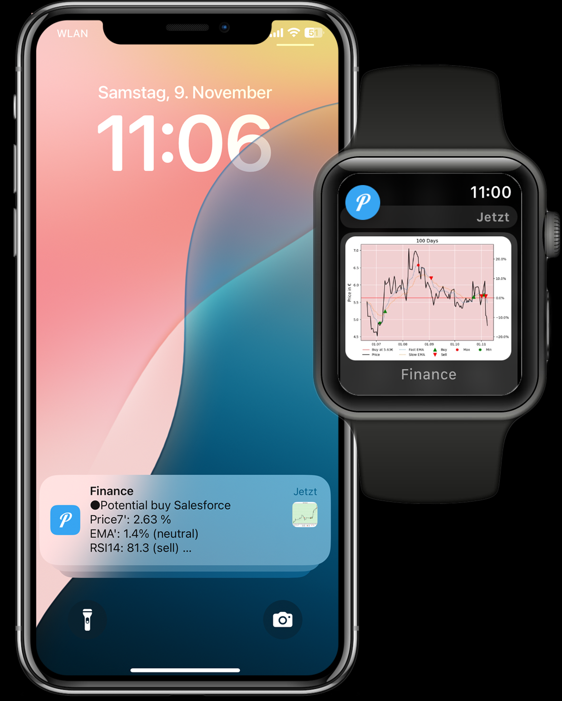
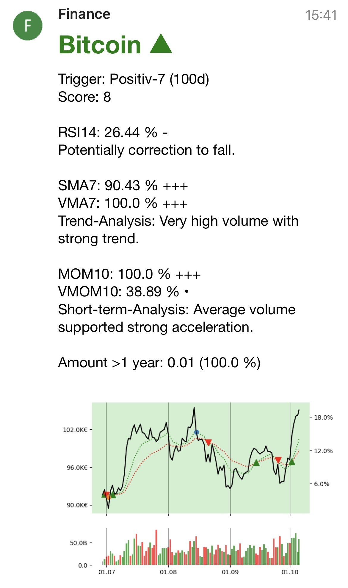

# Crypto and Stock Alert

## Overview

This project provides a Python-based system for analyzing and monitoring cryptocurrencies and stocks. It uses technical indicators like Moving Averages, RSI, Rate of Change, Bollinger Bands and Volume Analysis to evaluate trends and alert users on significant market conditions. The system tracks and visualizes data, calculates profits, and sends notifications and charts via a **Telegram bot**, which also accepts commands (analysis on demand, transactions, alarm settings, AI prompts).

## Why do I need CaSa?

I've always wanted to invest in stocks and cryptocurrencies, but I was held back by the fear of missing rapid market changes and, especially with crypto, the risk of losing significant money. Constantly monitoring prices felt overwhelming and stressful.

Moreover, I was never fully satisfied with the existing apps and their features for tracking price changes. Most of them offer only basic alert thresholds, while more advanced functionalities often come with a price tag.

That's why I decided to take matters into my own hands and developed CaSa—a free, open-source program now available on GitHub. CaSa is reliable and already includes several essential features, making it an excellent starting point for anyone facing the same challenges I did.

While it's functional and stable, there's still plenty of room for growth. Check out the "New Feature Idea List" for planned improvements and let's build something great together!



## Features

- **Automatic Data Retrieval**: Crypto data from CoinGecko, stock data from Yahoo Finance (foreign currencies are converted to EUR automatically)
- **Longer History in the Background**: 250 daily / 450 hourly values are loaded, indicators are calculated on the full history and then cut to a 100-value window (no warm-up gaps at the left chart edge)
- **Advanced Technical Analysis**: Multi-indicator scoring system combining:
  - **RSI14**: 14-day Relative Strength Index for overbought/oversold signals
  - **ROC5 & VROC5**: 5-period rate of change of price and volume with fake-out detection
  - **SMA7 & VMA7**: Short-term trend and volume analysis with fake-out detection
  - **EMA Crossovers**: Fast/Slow EMA (12/26) buy/sell signals
  - **Bollinger Bands (20,2)**
  - **7-Day Slope Analysis**: Price trend strength over weekly periods
- **Support/Resistance Zones**: Nearest resistance (R1) above and support (S1) below the price, built from pivot points of the full history and shown with number of touches
- **Smart Alarm System**:
  - Quantile-based signal strength (3 levels: +/-, ++/--, +++/---)
  - Volume-supported momentum detection
  - Duplicate alarm filtering (also across `/restart`)
  - Per-asset switch which assets are part of the automatic alarm analysis
- **Visual Analytics**: Charts with price, EMAs, Bollinger Bands, buy/sell markers, support/resistance zones, volume bars and a volume profile
- **Portfolio Tracking**: FIFO bookkeeping from `transactions.csv`, profit calculation and tax-relevant holding periods (>1 year)
- **AI Prompt**: `/ai` creates a ready-to-copy prompt for ChatGPT or Claude including technical data, bottom/top formation, market phase and your position (no AI API needed)
- **Event Reminders**: Important dates (earnings, central bank meetings, ...) in `events.ini` or via `/termin`; on the day at 08:00 a reminder plus a daily analysis of the asset is sent
- **Scheduling**: Hourly (100h) crypto analysis, daily (100d) analysis at 09:30 and 12:30, summary at 18:30
- **Daily Summaries**: Ranking image sorted by 1-day P&L

## What's New

- **Telegram bot instead of Pushover**: notifications, charts and commands in one chat
- **Charts**: trading-day axis without weekend gaps, 200 dpi, volume profile on the right, support/resistance zones with legend, percentage axis on the left
- **Messages**: clean HTML formatting in Telegram (bold headers, aligned values, no emojis)
- **Daily Summary**: modern ranking table with 1-day P&L bars and highlighted best performer
- **New commands**: `/check` and `/ai` with buttons, `/alarm` to switch assets on/off, `/sellall` to record the sale of a full position
- **`assets.ini`**: one list of all known assets; `; 1` marks assets for the automatic alarm analysis
- **AI prompt** with bottom/top formation (higher lows, RSI divergence, double bottom/top, volume climax, EMA confirmation) and market phase (price and SMA50 vs. SMA200, Golden/Death Cross) for the asset and its leading market (Bitcoin, DAX, S&P 500, FTSE MIB)
- **Bug fixes**: no duplicate daily crypto alarms, price no longer cut off at Bollinger breakouts, evening summary kept after `/buy` / `/sell`

## Project Structure

- `main.py`: Main program: loads configuration, schedules analyses, handles commands from the bot
- `classes.py`: `CryptoStock` class (data, transactions, analysis per asset), reading `assets.ini` and `transactions.csv`
- `func.py`: Data retrieval, indicators, support/resistance, alarms, charts and summary image
- `telegram_bot.py`: Telegram bot (runs as separate process, sends messages and forwards commands to `main.py`)
- `config.ini`: Version, alarm limits and Telegram access (must be created manually)
- `assets.ini`: All cryptos and stocks known to the program (must be created manually)
- `transactions.csv`: Buys and sells, written by the bot (`/buy`, `/sell`, `/sellall`)
- `ki_frage.txt`: Template for the `/ai` prompt; created automatically, can be edited freely
- `events.ini`: Important dates with reminder and analysis (optional, also written by `/termin`)

## Installation

1. Install Python 3
2. Windows: run `install_venv.bat` (creates `.venv` and installs `requirements.txt`)  
   Other systems: `python3 -m venv .venv` and `.venv/bin/pip install -r requirements.txt`
3. Create a Telegram bot with [@BotFather](https://t.me/BotFather) and note the token and your chat id
4. Create `config.ini` and `assets.ini` in the root directory (see **Configuration**)
5. Run the program: `python main.py`

**Note**: Tested on RockPi3 with Armbian OS and on Windows 11.

## Telegram Commands

| Command | Function |
|---|---|
| `/check` | Daily analysis of one asset without alarm (choose via buttons) |
| `/ai` | AI prompt to copy into ChatGPT or Claude (choose via buttons or `/ai <symbol>`) |
| `/analyse <daily\|hourly\|summary>` | Start an analysis immediately |
| `/alarm` | Switch assets on/off for the alarm analysis (buttons or `/alarm <symbol> <an\|aus>`) |
| `/buy <symbol> <crypto\|stock> <amount €> <qty> <DD/MM/YYYY>` | Record a buy |
| `/sell <symbol> <crypto\|stock> <amount €> <qty>` | Record a sell |
| `/sellall <symbol> [amount €]` | Record the sale of the full position (current price if no amount, confirmation required) |
| `/history <symbol>` | Transactions of one asset |
| `/transactions` | All transactions |
| `/status` | Bot status and number of transactions |
| `/restart` | Restart the main program |
| `/help` | Overview of all commands |

## Understanding the Alerts

**Alert Components:**
- **Trigger**: Condition that generated the alert (e.g., Cross-EMA, Positiv-5, 100-Minimum)
- **Score**: Combined indicator rating (scale -18 to +18, higher = stronger buy signal)
- **RSI14**: Quantile percentage with signal strength
- **Trend-Analysis (SMA7 & VMA7)** and **Short-term-Analysis (ROC5 & VROC5)**: trend and momentum with volume support and fake-out warnings
- **Amount >1 year**: Holdings older than one year (tax-relevant in some countries)

**Signal Strength:**
- `+++` / `---`: Very strong signal (top/bottom 10% quantile)
- `++` / `--`: Strong signal (10-20% quantile)
- `+` / `-`: Moderate signal (20-30% quantile)
- `●`: Neutral (30-70% quantile)

**Fake-Out Detection**: Warns when price movement lacks volume support

**Chart:**
- Grey band: Bollinger Bands, dotted lines: Fast/Slow EMA, triangles: EMA crossovers
- R1 / S1: nearest resistance and support zone (stronger colour = at least 2 touches)
- Grey bars on the right: volume profile of the visible range (darker bar = price level with most volume)
- Background green/red: current price above/below your average buy price



## Configuration

### config.ini

```ini
[version]
number = 1.2.0

[telegram]
token = YOUR_TELEGRAM_BOT_TOKEN
chat_id = YOUR_CHAT_ID

[alarm]
one_day_price_change = 10       # One-day price change threshold (%) - currently inactive
seven_day_price_change = 7      # ROC5 threshold for Positiv-5 / Negative-5 alarms (%)
previous_alarm_change = 3       # Minimum change between consecutive alarms
one_day_profit_limit = -2       # One-day profitability threshold (%) - currently inactive
test_mode = 0                   # 0 = scheduled analyses, 1 = run all analyses once at start
```

### assets.ini

```ini
# Format: symbol = Name; crypto|stock; 1
# 1 at the end = part of the automatic alarm analysis
# without 1    = only available for /check and /ai
# # at the start hides the entry completely

[crypto]
bitcoin        = Bitcoin; crypto; 1      # CoinGecko ID
cardano        = Cardano; crypto

[stocks]
QCOM           = Qualcomm; stock; 1      # Yahoo Finance symbol
APC.DE         = Apple; stock
```

The `1` can also be switched in Telegram with `/alarm`.

### events.ini

```ini
# Format: name = symbol; DD/MM/YYYY; description
[events]
nvda_20261117  = NVDA; 17/11/2026; Q3 earnings after US market close
```

### transactions.csv

Written by the bot, one line per buy/sell:

```
type;symbol;name;action;amount;qty;date
crypto;bitcoin;Bitcoin;buy;500.0;0.01;01/01/2024
stock;QCOM;Qualcomm;sell;312.16;2.0;14/11/2026
```

## Dependencies

- **Python Libraries**: see `requirements.txt` (`pandas`, `numpy`, `scipy`, `matplotlib`, `yfinance`, `requests`, `schedule`, `python-telegram-bot`, ...)
- **External Services**: Telegram (free bot), CoinGecko, Yahoo Finance

## License

This project is licensed under the MIT License.

## Disclaimer

This application generates alerts based on technical indicators and market data analysis. All alerts are purely informational and require independent user evaluation. Users are solely responsible for their own investment decisions. CaSa does not recommend buying or selling any assets, nor does it provide personalized investment advice. Answers of AI tools to the `/ai` prompt are not investment advice either.

## Links

- [Telegram BotFather](https://t.me/BotFather) — Create a Telegram bot
- [CoinGecko](https://www.coingecko.com) — Cryptocurrency market data
- [Yahoo Finance](https://finance.yahoo.com) — Stock market data
- [Rock Pi](https://rockpi.org/) — Single-board computer for hosting
- [Armbian OS](https://www.armbian.com/) — Lightweight ARM-based OS
